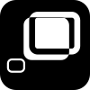

<p align="center">
  <a href="https://201tech.net"></a>
</p>

<h1 align="center">201tech</h1>

<p align="center">
  <b>We build software that people actually use.</b><br>
  Independent product studio and software house.
</p>

<p align="center">
  <a href="https://201tech.net">201tech.net</a> ·
  <a href="https://201tech.net/pt-br/">Português</a> ·
  <a href="mailto:contato@201tech.net">contato@201tech.net</a>
</p>

<br>

```js
while (product.alive) { discover(); design(); build(); ship(); }
```

We launch our own products and build software for clients, from the first sketch to production.

## What we build

| | |
|---|---|
| 📱 **Mobile apps** | 🌐 **Web platforms** |
| ⚙️ **APIs and backends** | ☁️ **Cloud and infrastructure** |
| 🤖 **AI and automation** | 💳 **Payments and marketplaces** |

New products, custom software, backoffices, SaaS, and senior dedicated teams.

## How we work

| | | |
|---|---|---|
| **v0.5** | Design and prototype | You click through your product before it is built. |
| **v1.0** | Build and launch | Working versions along the way, then production. |
| **v1.x** | Evolve and support | Real data, continuous improvements, or a full handover. |

## Why 201tech

- **We are our own client.** We run products in production, so we know what it takes to keep one alive.
- **Senior by default.** Small teams of experienced people, no layers between you and who writes the code.
- **Secure from the start.** Privacy, security and compliance are part of the design, not a final checklist.
- **You own everything.** Code, infrastructure, accounts and documentation are yours from the first commit.

## Have an idea?

**Let's build it.** Write to [contato@201tech.net](mailto:contato@201tech.net) or visit [201tech.net](https://201tech.net).
