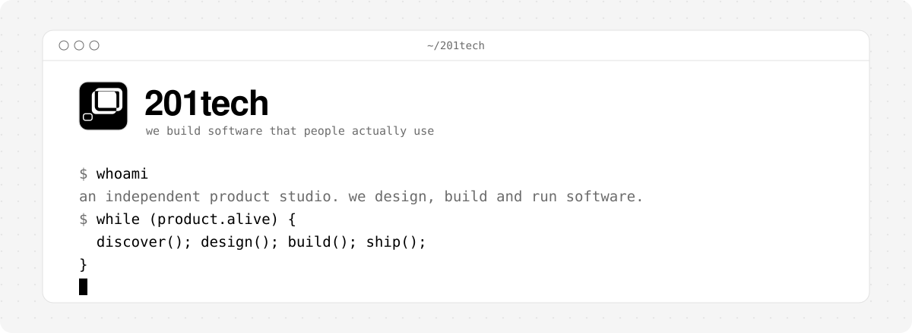
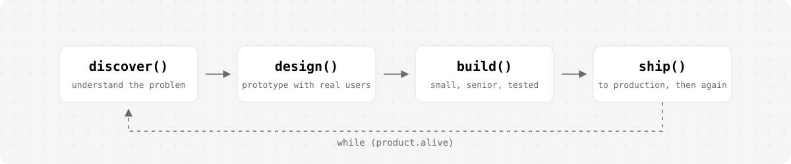

<picture>
  <source media="(prefers-color-scheme: dark)" srcset="./hero-dark.svg">
  
</picture>

<br>

We are a small team of engineers who design, build and run software in production. Our own products and products for the people we work with, from the first sketch to the thousandth deploy.

### `> what we build`

```txt
mobile apps          web platforms          apis & backends
cloud & infra        ai & automation        payments & marketplaces
```

### `> how we build`

<picture>
  <source media="(prefers-color-scheme: dark)" srcset="./loop-dark.svg">
  
</picture>

- **We run what we build.** Everything we ship lives in production with someone on our side keeping it alive.
- **Small and senior.** No layers between the problem and the person writing the code.
- **Code for humans.** Readable over clever, configuration over hardcoded values, minimal dependencies.
- **Secure from the first commit.** Privacy and security are part of the design, not a final checklist.
- **Ship small, ship often.** Short loops with real users beat long plans.
- **Yours from day one.** Code, infrastructure and documentation belong to whoever owns the product.

### `> stack`

<picture>
  <source media="(prefers-color-scheme: dark)" srcset="./stack-dark.svg">
  
</picture>

<br>

<p align="center">
  <a href="https://201tech.net"><b>201tech.net</b></a>
  &nbsp;·&nbsp;
  <a href="mailto:contato@201tech.net">contato@201tech.net</a>
</p>
